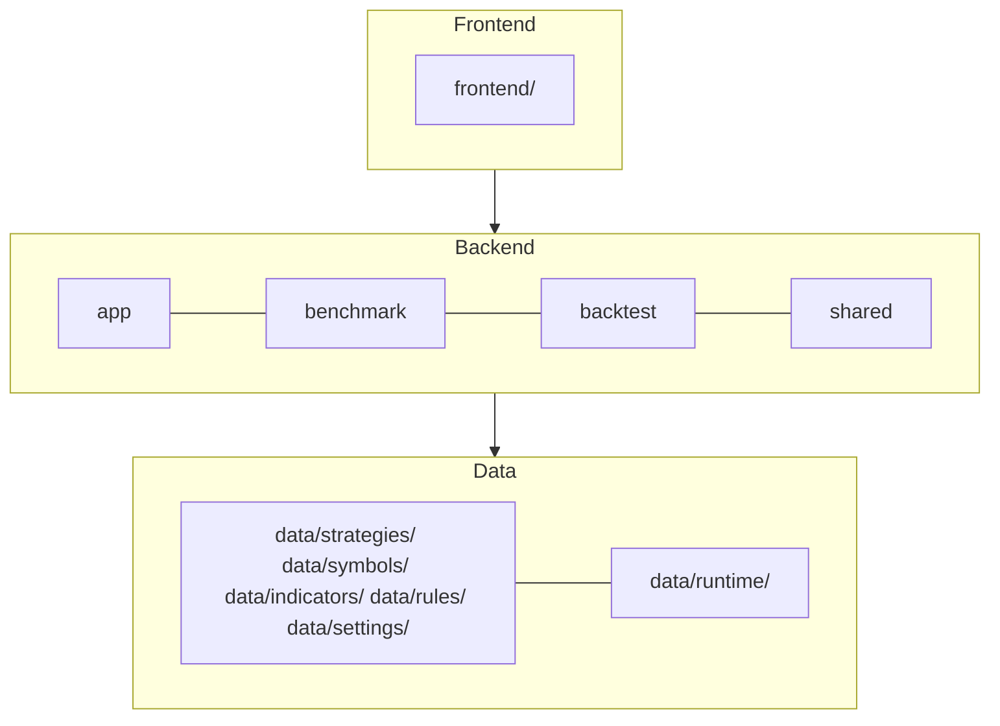

# Stock Benchmark

A personal stock dashboard. It shows market indicators and followed symbols, each with a **pass** result and a **score**. Select a symbol to see its strategy tree, gate by gate and rule by rule.

## Architecture

Planned layout after the refactor (the code is not yet moved):



## Setup

```bash
python3 -m venv .venv && .venv/bin/pip install -r requirements.txt
```

## Run

```bash
.venv/bin/python -m uvicorn stock_benchmark_backend.web_server:app --port 8000
```

Open http://localhost:8000. Data refreshes in the background while the US market is open. Refresh once by hand:

```bash
.venv/bin/python -m stock_benchmark_backend.refresh_scheduler --once
```

## Test

```bash
.venv/bin/python -m pytest tests
```

## Where things are

| To change | Edit |
|---|---|
| Followed symbols | `config/symbols.yaml` |
| Strategies | `config/strategies/*.yaml` (see `docs/strategy.md`) |
| Rules and indicators | `config/rules.yaml`, `config/indicators.yaml` (see `docs/indicator.md`) |
| Refresh interval, sidebar indicators | `config/settings.yaml` |
| Page design | `docs/design.md` |
| JSON API | `docs/api.md` |
| Deployment | `docs/deployment.md` |

Restart the server after changing any YAML file.

## Version and license

The version is in `version.txt` (`MAJOR.MINOR.PATCH`). The page header and `GET /api/v1/version` read it, so a release changes only that file. The code is MIT licensed; see `LICENSE`. Icons come from Tabler Icons (MIT, see `licenses/`); `scripts/build_icons.py` rebuilds them after `npm install`.
